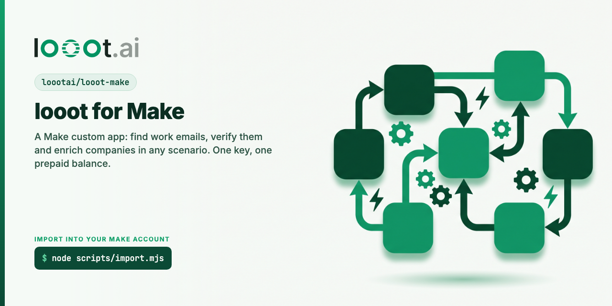

<p align="center"></p>

# looot-make

[](LICENSE) [](https://docs.looot.ai)

A Make custom app for [looot](https://looot.ai): one key and one prepaid balance for 4,200+ data endpoints
from 300+ providers. A scenario can find a work email, verify it, enrich a company, or run any other
endpoint in the catalog. You see the price before a run and a failed call costs nothing.

Status: source only. The files pass Make's own JSON schemas, but the app has not been created in a Make
account or run in a scenario yet. See "Not checked yet" before you rely on it.

## What is in the app

`src/` holds the app in the layout the Make Apps SDK for VS Code uses for local development: one
`makecomapp.json` manifest, the base, one connection and ten modules, 59 files.

| Module | Type | REST route | Cost |
|---|---|---|---|
| Find a work email | action | `POST /v1/runs` with `job:people.email.find` | from $0.003598 per call |
| Verify an email | action | `POST /v1/runs` with `job:people.email.verify` | from $0.00145 per call |
| Enrich a company | action | `POST /v1/runs` with `job:company.enrich` | from $0.0019 per call |
| Run an operation | action | `POST /v1/runs` with any endpoint or `job:<id>` | the endpoint's price |
| Search operations | search | `GET /v1/catalog/search?q=` | free |
| Get an operation | action | `GET /v1/operations/{endpointId}` | free |
| Get a run | action | `GET /v1/runs/{runId}` | free |
| Get the balance | action | `GET /v1/balance` | free |
| Watch finished runs | polling trigger | `GET /v1/runs?limit=50` | free |
| Make an API call | universal | any path under `https://api.looot.ai` | depends on the call |

Prices are the cheapest provider of each job in the public catalog
(`GET https://api.looot.ai/v1/catalog/overview?depth=jobs`) on 2026-10-08. They change; Search operations
returns the live price.

### Connection

API key. One field, Agent token, created in the looot dashboard under Settings, Agent tokens, with
`catalog.read`, `runs.read`, `runs.execute` and `usage.read`. The connection test calls `GET /v1/balance`
and stores the workspace id as the connection's label. The base sends `Authorization: Bearer <token>` and
masks that header in Make's logs.

### How a run module behaves

- **Body.** `{"endpointId", "input", "idempotencyKey", "wait", "fallback"}`, the same body the looot n8n
  node sends.
- **Try other providers** is on by default and sends `fallback: true`. With Max cost (USD) filled it sends
  `{"enabled": true, "maxCostUsd": <n>}`. looot tries the next provider of the same job when the first
  finds nothing and charges only the attempts that ran.
- **Wait (seconds)** defaults to 20 and stops at 30, under Make's 40 second module limit. A run that
  takes longer comes back `queued` or `running`. Read it with Get a run, or start a second scenario from
  Watch finished runs.
- **Idempotency key.** Empty by default. The module then sends `make-` plus the SHA-256 of the endpoint,
  the module's input and the UTC date. Running the same lookup again on the same day replays the first
  run and pays once. Fill the field to use your own key.
- **Output.** `runId`, `status`, `actualCost`, the provider's raw `result` and looot's
  [normalized output](https://docs.looot.ai/concepts/normalized-output). Find a work email adds `email`
  and `check`. Verify an email adds `emailStatus` and `deliverable`. Enrich a company adds `companyName`,
  `companyDomain`, `industry` and `size`. These are empty when the provider that answered has no field
  map; `result` is always there.
- **Errors.** looot answers HTTP 201 even when a run failed before it started, so each run module marks a
  response with status `failed`, `blocked` or `stopped` as invalid and shows looot's error code and
  message. HTTP 402 shows the top-up link.

## Put it in your Make account

Make has no file upload for custom apps. There are two ways in. Both need a Make account and a Make API
token with the `sdk-apps:read` and `sdk-apps:write` scopes (Make profile, API access).

### Option A: the import script

```bash
git clone https://github.com/loootai/looot-make && cd looot-make
node scripts/import.mjs                  # dry run: prints the 68 calls, sends nothing
MAKE_API_TOKEN=<token> MAKE_ZONE=eu1.make.com node scripts/import.mjs --apply
```

`MAKE_ZONE` is the host you see in the browser when you use Make (`eu1.make.com`, `eu2.make.com`,
`us1.make.com`, `us2.make.com`). The script creates the app, the connection and the ten modules through
`/api/v2/sdk/apps`, then uploads each code file. It stops at the first call Make refuses and prints
Make's answer. To load the files into an app that already exists, add `--app <app name>`.

### Option B: VS Code

1. Install the Make Apps SDK extension and add your API token to it.
2. In the Make web app, create a custom app named looot.
3. Open this repo in VS Code. In `src/makecomapp.json`, add your app to `origins`:
   ```json
   { "label": "looot", "baseUrl": "https://eu1.make.com/api", "appId": "<your app name>", "appVersion": 1, "apikeyFile": "../.secrets/apikey" }
   ```
4. Right-click `makecomapp.json` and pick Deploy to Make. The extension asks how to pair each local
   component the first time; choose to create it.

Then upload `assets/icon-512.png` as the app logo, create a connection with a looot token, and run each
module once in a test scenario.

## Not checked yet

Nothing here has run on Make. What the tests cover is the file structure. The first live scenario should
confirm these, in this order:

1. The IML expressions for the idempotency key and the fallback object evaluate as written
   (`sha256`, `createJSON`, `parseJSON`, `formatDate` and `ifempty` are documented built-in functions).
2. Make leaves an empty optional field out of the JSON body. If it sends `null` for an empty First name,
   looot may refuse the input.
3. Watch finished runs picks up a run that finishes after the scenario last polled.
4. The import script against the real API. It follows the documented routes and the calls the VS Code
   extension makes, and it is tested against a local stand-in for Make's API only.

## Scenario templates

[templates/](templates) holds 13 importable scenario blueprints built on this app: Google Maps leads, work email waterfall, form leads to HubSpot, competitor cards, daily competitor news and hiring alerts in Slack, signup scoring and more. Five of them redo popular n8n gallery templates with one data account instead of two or three. None has run in Make yet; [templates/README.md](templates/README.md) says what to check.

## Test

```bash
npm ci --ignore-scripts
npm test
```

`npm test` downloads Make's JSON schemas for custom app files from the Make Apps SDK for VS Code
(`integromat/vscode-apps-sdk`, pinned to commit `6ff5f3d`) into `.cache/`, then checks every file in
`src/` against the schema for its type, checks Make's naming rules, and runs the import script against a
local HTTP server. No test calls looot or Make. Output on 2026-10-08, Node 24.18.0:

```
ℹ tests 17
ℹ pass 17
ℹ fail 0
```

## Publish in Make (maintainers)

Make reviews an app before it is public. Docs read on 2026-10-08:
https://developers.make.com/custom-apps-documentation/app-review/prerequisites and
https://developers.make.com/custom-apps-documentation/app-review/request-app-review.

1. Run every module in a test scenario and keep those scenarios; Make asks for them.
2. In the app's page click Publish, then switch each module to visible. A published app cannot be
   unpublished and its modules cannot be deleted.
3. Request the review from the same page.
4. After approval, apply to the technology partner program at https://www.make.com/en/technology-partners.

## Docs used

Read on 2026-10-08:

- App structure: https://developers.make.com/custom-apps-documentation/app-components/base
- API key connection: https://developers.make.com/custom-apps-documentation/app-components/connections/basic-connection
- Modules: https://developers.make.com/custom-apps-documentation/app-components/modules
- Universal module: https://developers.make.com/custom-apps-documentation/app-components/modules/universal-module/rest
- Naming: https://developers.make.com/custom-apps-documentation/best-practices/naming-conventions/modules/module-labels
- Local development layout: https://developers.make.com/custom-apps-documentation/get-started/make-apps-editor/apps-sdk/local-development-for-apps
- API: https://developers.make.com/api-documentation/api-reference/sdk-apps

## Related

- [looot-zapier](https://github.com/loootai/looot-zapier), [n8n-nodes-looot](https://github.com/loootai/n8n-nodes-looot), [looot-activepieces](https://github.com/loootai/looot-activepieces): the same operations on other automation tools.
- [looot-mcp](https://github.com/loootai/looot-mcp): the remote MCP server, `claude mcp add --transport http looot https://api.looot.ai/mcp`.
- [awesome-gtm](https://github.com/loootai/awesome-gtm): open-source GTM tools.

MIT, copyright looot.
